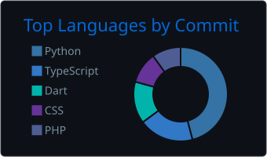

  

  

  

  
  
  

<!-- ===================== INFORMACIÓN INSTITUCIONAL ===================== -->

  

  

<table align="center">
  <tr>
    <th> Dato</th>
    <th> Información</th>
  </tr>
  <tr><td><b>Nombre</b></td><td>Daniel de Jesús Sánchez Sierra</td></tr>
  <tr><td><b>Programa</b></td><td>Técnico Profesional en Desarrollo de Software</td></tr>
  <tr><td><b>Universidad</b></td><td>Universidad de la Costa (CUC)</td></tr>
  <tr><td><b>Semestre</b></td><td>2.º semestre</td></tr>
  <tr><td><b>Correo institucional</b></td><td><a href="mailto:dsanchezs3@cuc.edu.co">dsanchezs3@cuc.edu.co</a></td></tr>
  <tr><td><b>Ubicación</b></td><td>Barranquilla, Colombia</td></tr>
  <tr><td><b>GitHub</b></td><td><a href="https://github.com/DanielDev0625">DanielDev0625</a></td></tr>
</table>

<!-- ===================== EMPRENDIMIENTO ===================== -->

  

  

  <a href="https://suva-software.vercel.app">
    <picture>
      <source media="(prefers-color-scheme: dark)" srcset="./logo-suva-dark.png" />
      <source media="(prefers-color-scheme: light)" srcset="./logo-suva-light.png" />
      
    </picture>
  </a>

  Cofundador de <b>SUVA Enterprise Software Architecture</b>, empresa de desarrollo de software en Barranquilla 
  enfocada en soluciones a la medida, aplicaciones y automatización para emprendedores y empresas.

<!-- ===================== INTERESES ===================== -->

  

  

<table align="center">
  <tr>
    <th> Intereses</th>
    <th> Gustos</th>
    <th> Pasatiempos</th>
  </tr>
  <tr><td>Desarrollo de aplicaciones móviles</td><td>Construir productos que resuelvan problemas reales</td><td>Videojuegos de estrategia, fútbol y acción</td></tr>
  <tr><td>Desarrollo web y APIs</td><td>La música y aprender tecnologías nuevas</td><td>Crear contenido de programación en YouTube</td></tr>
  <tr><td>Automatización con Python</td><td>Emprender con proyectos propios</td><td>Programar proyectos personales</td></tr>
  <tr><td>Arquitectura de software y nube</td><td>Trabajar en equipo</td><td>Escuchar música mientras programo</td></tr>
</table>

<!-- ===================== TECNOLOGÍAS ===================== -->

  

  

<table align="center">
  <tr>
    <th> Categoría</th>
    <th> Herramientas</th>
  </tr>
  <tr>
    <td><b>Lenguajes</b></td>
    <td></td>
  </tr>
  <tr>
    <td><b>Frameworks y librerías</b></td>
    <td> </td>
  </tr>
  <tr>
    <td><b>Bases de datos y herramientas</b></td>
    <td></td>
  </tr>
  <tr>
    <td><b>Aprendiendo</b></td>
    <td> </td>
  </tr>
</table>

<!-- ===================== PROYECTOS ===================== -->

  

  

<table align="center">
  <tr>
    <th> Proyecto</th>
    <th> Descripción</th>
    <th> Tecnologías</th>
  </tr>
  <tr>
    <td><a href="https://suva-software.vercel.app"><b>SUVA</b></a></td>
    <td>Empresa de desarrollo de software que cofundé: soluciones a la medida, aplicaciones y automatización.</td>
    <td>PHP, CSS, JavaScript</td>
  </tr>
  <tr>
    <td><b>NOVATECH</b></td>
    <td>Sistema de gestión con backend en FastAPI y aplicación móvil en Flutter para el personal, con inicio de sesión biométrico y navegación por rol.</td>
    <td>Python, FastAPI, Flutter</td>
  </tr>
  <tr>
    <td><a href="https://github.com/DanielDev0625/Proyecto-Saas"><b>MartGo</b></a></td>
    <td>SaaS de inventario, ventas y fiados para tiendas de barrio, desplegado en AWS con integración y despliegue continuos. Proyecto de Buenas Prácticas de Desarrollo de Software.</td>
    <td>Next.js, TypeScript, PostgreSQL, AWS</td>
  </tr>
</table>

<!-- ===================== ESTADÍSTICAS ===================== -->

  

  

  

  
  

  

<!-- ===================== CONTACTO ===================== -->

  

  

  
  
  

  

