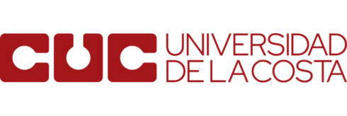
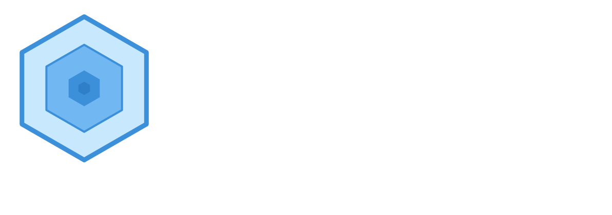
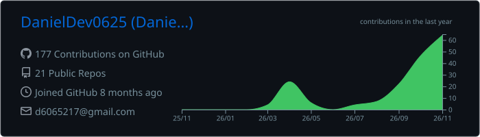
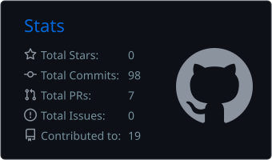

  

  

  Estudiante de desarrollo de software en la Universidad de la Costa, con interés en aplicaciones móviles, desarrollo web y automatización de procesos.

---

## Información institucional

| Dato | Información |
|---|---|
| **Nombre** | Daniel de Jesús Sánchez Sierra |
| **Programa** | Técnico Profesional en Desarrollo de Software |
| **Universidad** | Universidad de la Costa (CUC) |
| **Semestre** | 2.º semestre |
| **Correo institucional** | [dsanchezs3@cuc.edu.co](mailto:dsanchezs3@cuc.edu.co) |
| **Ubicación** | Barranquilla, Colombia |
| **GitHub** | [DanielDev0625](https://github.com/DanielDev0625) |

---

## Emprendimiento

  <a href="https://suva-software.vercel.app">
    <picture>
      <source media="(prefers-color-scheme: dark)" srcset="./logo-suva-dark.png" />
      <source media="(prefers-color-scheme: light)" srcset="./logo-suva-light.png" />
      
    </picture>
  </a>

  Cofundador de SUVA Enterprise Software Architecture, empresa de desarrollo de software en Barranquilla enfocada en soluciones a la medida, aplicaciones y automatización.

---

## Intereses, gustos y pasatiempos

| Intereses | Gustos | Pasatiempos |
|---|---|---|
| Desarrollo de aplicaciones móviles | Construir productos que resuelvan problemas reales | Videojuegos de estrategia, fútbol y acción |
| Desarrollo web y APIs | La música y aprender tecnologías nuevas | Crear contenido de programación en YouTube |
| Automatización con Python | Emprender con proyectos propios | Programar proyectos personales |
| Arquitectura de software y nube | Trabajar en equipo | Escuchar música mientras programo |

---

## Tecnologías

  
    
  
    
  

  
  
  

---

## Proyectos

| Proyecto | Descripción | Tecnologías |
|---|---|---|
| [SUVA](https://suva-software.vercel.app) | Empresa de desarrollo de software que cofundé: soluciones a la medida, aplicaciones y automatización para emprendedores y empresas. | PHP, CSS, JavaScript |
| NOVATECH | Sistema de gestión con backend en FastAPI y aplicación móvil en Flutter para el personal, con inicio de sesión biométrico y navegación por rol. | Python, FastAPI, Flutter |
| [MartGo](https://github.com/DanielDev0625/Proyecto-Saas) | SaaS de inventario, ventas y fiados para tiendas de barrio, desplegado en AWS con integración y despliegue continuos. Proyecto de Buenas Prácticas de Desarrollo de Software. | Next.js, TypeScript, PostgreSQL, AWS |

---

## Estadísticas

  

  
  

  

---

## Contacto

  
  
  

